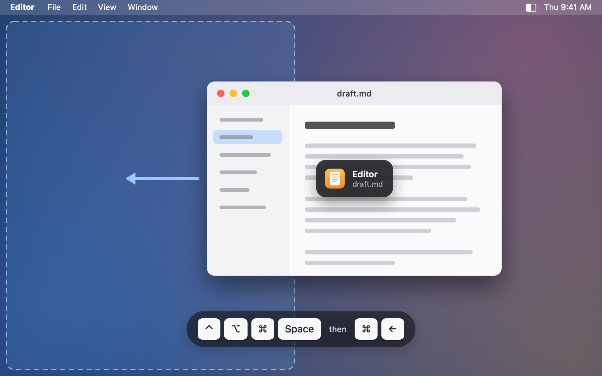

<p align="center">
  
</p>

# Twain

Years ago I paid $15 for a Mac app that moved windows around with the keyboard. It was kind of slow, but it was fine.

Then one day a macOS update broke it.

I wanted a better version that I controlled, so I made this.

## What it does

Press **⌃⌥⌘Space**, then **⌘←**, **⌘→**, **⌘↑** or **⌘↓**. The frontmost window moves to that half of the screen. **Esc** cancels.

That's it. There are no options. It works the way I want it to. If you want it to work differently, the code is about 500 lines of Swift: change it yourself, or have an AI change it for you.

## Install

Needs macOS 13 or later and the Xcode Command Line Tools (`xcode-select --install`).

```sh
git clone https://github.com/franktisellano/twain.git && cd twain
./build.sh install
```

The first time it runs, Twain asks for Accessibility permission (System Settings → Privacy & Security → Accessibility). macOS requires that before one app can move another app's windows.

`build.sh` signs the app with a developer identity from your keychain if you have one, so the permission survives rebuilds. Use `TWAIN_SIGN_ID` to choose a specific identity. Without one, you'll have to grant the permission again after every build.

## License

[MIT](LICENSE)
